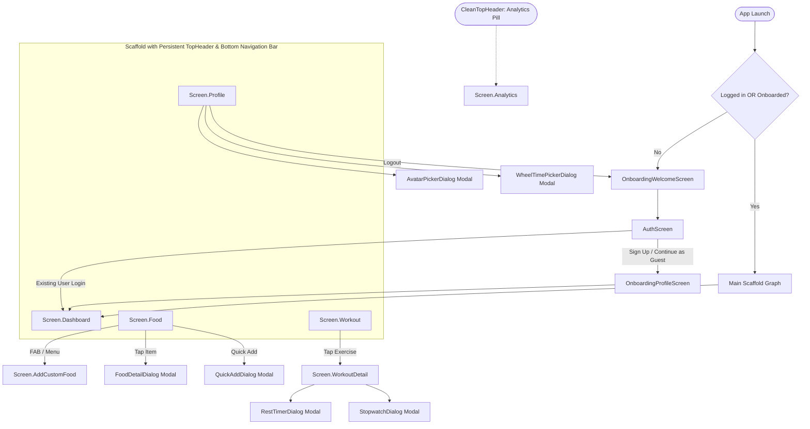

# Design System Audit & Specification Report: "GetFit" Android App

---

## 1. DESIGN TOKENS

### Full File Contents

#### `Color.kt`
```kotlin
package com.getfit.ui.theme

import androidx.compose.ui.graphics.Color

// Clean Design Palette (Editorial, Whitespace-first, Linear/Stripe inspired)
val CleanPrimary = Color(0xFF0F0E0C)         // Near-black
val CleanBackground = Color(0xFFFFFFFF)      // Pure white
val CleanSurface = Color(0xFFFFFFFF)
val CleanSurfaceVariant = Color(0xFFF7F6F2) // Warm off-white alternate surface
val CleanBorder = Color(0xFFE8E6E1)         // Subtle warm gray border
val CleanOnPrimary = Color(0xFFFFFFFF)
val CleanOnSurface = Color(0xFF0F0E0C)
val CleanOnSurfaceVariant = Color(0xFF6B6760) // Warm medium gray for secondary copy
val CleanTextMuted = Color(0xFFA8A49F)      // Muted captions & overlines

// Inverted OLED Dark Palette
val CleanDarkPrimary = Color(0xFFFFFFFF)
val CleanDarkOnPrimary = Color(0xFF000000)
val CleanDarkBackground = Color(0xFF050505)
val CleanDarkSurface = Color(0xFF121212)
val CleanDarkSurfaceVariant = Color(0xFF1A1A1A)
val CleanDarkBorder = Color(0xFF262626)
val CleanDarkOnBackground = Color(0xFFFFFFFF)
val CleanDarkOnSurface = Color(0xFFFFFFFF)
val CleanDarkOnSurfaceVariant = Color(0xFFA3A3A3)
val CleanDarkTextMuted = Color(0xFF737373)

// Primary Green (Accent)
val Green80 = Color(0xFFA5D6A7)
val Green60 = Color(0xFF66BB6A)
val Green50 = Color(0xFF16A34A) // Clean green accent
val Green40 = Color(0xFF15803D)
val Green30 = Color(0xFF166534)
val Green20 = Color(0xFF14532D)

// Secondary & Tertiary
val Teal80 = Color(0xFF80CBC4)
val Teal40 = Color(0xFF00897B)
val Orange80 = Color(0xFFFFCC80)
val Orange40 = Color(0xFFEF6C00)

// Neutral
val Gray10 = Color(0xFF0F0E0C)
val Gray20 = Color(0xFF2F3033)
val Gray90 = Color(0xFFE2E2E5)
val Gray95 = Color(0xFFF7F6F2)
val Gray99 = Color(0xFFFFFFFF)

// Error
val Red80 = Color(0xFFFFB4AB)
val Red40 = Color(0xFFDC2626)

// Semantic Macro & Metric Indicators (Refined)
val CaloriesOrange = Color(0xFFEA580C)
val ProteinBlue = Color(0xFF2563EB)
val CarbsAmber = Color(0xFFD97706)
val FatRed = Color(0xFFDC2626)
val WaterBlue = Color(0xFF0284C7)
val FiberGreen = Color(0xFF16A34A)
```

---

#### `Type.kt`
```kotlin
package com.getfit.ui.theme

import androidx.compose.material3.Typography
import androidx.compose.ui.text.TextStyle
import androidx.compose.ui.text.font.FontFamily
import androidx.compose.ui.text.font.FontWeight
import androidx.compose.ui.unit.sp

val Typography = Typography(
    displayLarge = TextStyle(
        fontFamily = FontFamily.Default,
        fontWeight = FontWeight.Bold,
        fontSize = 36.sp,
        lineHeight = 44.sp,
        letterSpacing = 0.sp
    ),
    displayMedium = TextStyle(
        fontFamily = FontFamily.Default,
        fontWeight = FontWeight.Bold,
        fontSize = 28.sp,
        lineHeight = 36.sp,
        letterSpacing = 0.sp
    ),
    headlineLarge = TextStyle(
        fontFamily = FontFamily.Default,
        fontWeight = FontWeight.SemiBold,
        fontSize = 24.sp,
        lineHeight = 32.sp,
        letterSpacing = 0.sp
    ),
    headlineMedium = TextStyle(
        fontFamily = FontFamily.Default,
        fontWeight = FontWeight.SemiBold,
        fontSize = 20.sp,
        lineHeight = 28.sp,
        letterSpacing = 0.sp
    ),
    titleLarge = TextStyle(
        fontFamily = FontFamily.Default,
        fontWeight = FontWeight.SemiBold,
        fontSize = 22.sp,
        lineHeight = 28.sp,
        letterSpacing = 0.sp
    ),
    titleMedium = TextStyle(
        fontFamily = FontFamily.Default,
        fontWeight = FontWeight.Medium,
        fontSize = 16.sp,
        lineHeight = 24.sp,
        letterSpacing = 0.15.sp
    ),
    bodyLarge = TextStyle(
        fontFamily = FontFamily.Default,
        fontWeight = FontWeight.Normal,
        fontSize = 16.sp,
        lineHeight = 24.sp,
        letterSpacing = 0.5.sp
    ),
    bodyMedium = TextStyle(
        fontFamily = FontFamily.Default,
        fontWeight = FontWeight.Normal,
        fontSize = 14.sp,
        lineHeight = 20.sp,
        letterSpacing = 0.25.sp
    ),
    labelLarge = TextStyle(
        fontFamily = FontFamily.Default,
        fontWeight = FontWeight.Medium,
        fontSize = 14.sp,
        lineHeight = 20.sp,
        letterSpacing = 0.1.sp
    ),
    labelMedium = TextStyle(
        fontFamily = FontFamily.Default,
        fontWeight = FontWeight.Medium,
        fontSize = 12.sp,
        lineHeight = 16.sp,
        letterSpacing = 0.5.sp
    )
)
```

---

#### `Shape.kt`
> **File Status**: `Shape.kt` **does not exist** in `android/app/src/main/java/com/getfit/ui/theme/`. Material 3's centralized `Shapes` token set is unused; corner radii are instantiated ad-hoc via hardcoded `RoundedCornerShape(...)` throughout individual composables.

---

#### `Theme.kt`
```kotlin
package com.getfit.ui.theme

import android.app.Activity
import android.os.Build
import androidx.compose.foundation.isSystemInDarkTheme
import androidx.compose.material3.MaterialTheme
import androidx.compose.material3.darkColorScheme
import androidx.compose.material3.dynamicDarkColorScheme
import androidx.compose.material3.dynamicLightColorScheme
import androidx.compose.material3.lightColorScheme
import androidx.compose.runtime.Composable
import androidx.compose.runtime.SideEffect
import androidx.compose.ui.graphics.Color
import androidx.compose.ui.graphics.toArgb
import androidx.compose.ui.platform.LocalContext
import androidx.compose.ui.platform.LocalView
import androidx.core.view.WindowCompat

private val DarkColorScheme = darkColorScheme(
    primary = CleanDarkPrimary,
    onPrimary = CleanDarkOnPrimary,
    primaryContainer = CleanDarkSurfaceVariant,
    onPrimaryContainer = CleanDarkOnSurface,
    secondary = CleanDarkPrimary,
    onSecondary = CleanDarkOnPrimary,
    secondaryContainer = CleanDarkSurfaceVariant,
    onSecondaryContainer = CleanDarkOnSurface,
    tertiary = Orange80,
    onTertiary = CleanDarkOnPrimary,
    tertiaryContainer = CleanDarkSurfaceVariant,
    onTertiaryContainer = CleanDarkOnSurface,
    error = Red40,
    onError = Color.White,
    background = CleanDarkBackground,
    onBackground = CleanDarkOnBackground,
    surface = CleanDarkSurface,
    onSurface = CleanDarkOnSurface,
    surfaceVariant = CleanDarkSurfaceVariant,
    onSurfaceVariant = CleanDarkOnSurfaceVariant,
    outline = CleanDarkBorder
)

private val LightColorScheme = lightColorScheme(
    primary = CleanPrimary,
    onPrimary = CleanOnPrimary,
    primaryContainer = CleanSurfaceVariant,
    onPrimaryContainer = CleanOnSurface,
    secondary = CleanPrimary,
    onSecondary = CleanOnPrimary,
    secondaryContainer = CleanSurfaceVariant,
    onSecondaryContainer = CleanOnSurface,
    tertiary = Orange40,
    onTertiary = CleanOnPrimary,
    tertiaryContainer = CleanSurfaceVariant,
    onTertiaryContainer = CleanOnSurface,
    error = Red40,
    onError = CleanOnPrimary,
    background = CleanSurfaceVariant, // #F7F6F2 screen background matching web app
    onBackground = CleanOnSurface,
    surface = CleanBackground,        // #FFFFFF card background
    onSurface = CleanOnSurface,
    surfaceVariant = CleanSurfaceVariant,
    onSurfaceVariant = CleanOnSurfaceVariant,
    outline = CleanBorder
)

@Composable
fun GetFitTheme(
    themeMode: String = "SYSTEM", // "SYSTEM", "LIGHT", "DARK"
    darkTheme: Boolean = isSystemInDarkTheme(),
    dynamicColor: Boolean = false, // Clean design palette showcased by default
    content: @Composable () -> Unit
) {
    val isDark = when (themeMode) {
        "LIGHT" -> false
        "DARK" -> true
        else -> darkTheme
    }

    val colorScheme = when {
        dynamicColor && Build.VERSION.SDK_INT >= Build.VERSION_CODES.S -> {
            val context = LocalContext.current
            if (isDark) dynamicDarkColorScheme(context) else dynamicLightColorScheme(context)
        }
        isDark -> DarkColorScheme
        else -> LightColorScheme
    }

    val view = LocalView.current
    if (!view.isInEditMode) {
        SideEffect {
            val window = (view.context as Activity).window
            // Dynamic status bar adapting to light vs dark mode
            window.statusBarColor = if (isDark) Color(0xFF0A0A0A).toArgb() else CleanBackground.toArgb()
            WindowCompat.getInsetsController(window, view).isAppearanceLightStatusBars = !isDark
        }
    }

    MaterialTheme(
        colorScheme = colorScheme,
        typography = Typography,
        content = content
    )
}
```

---

### Complete Color Palette & Token Roles

| Token Name | Light Mode Hex | Dark Mode Hex | Semantic Role / Component Mapping |
| :--- | :--- | :--- | :--- |
| `primary` | `#0F0E0C` | `#FFFFFF` | Primary actions, CTA buttons, active state indicators |
| `onPrimary` | `#FFFFFF` | `#000000` | Text/icons placed over primary buttons |
| `background` | `#F7F6F2` | `#050505` | Full-screen scaffolding background |
| `onBackground` | `#0F0E0C` | `#FFFFFF` | Primary text rendered directly on screen canvas |
| `surface` | `#FFFFFF` | `#121212` | Elevated card containers, modals, bottom sheets |
| `onSurface` | `#0F0E0C` | `#FFFFFF` | Primary card headings, values, and strong labels |
| `surfaceVariant` | `#F7F6F2` | `#1A1A1A` | Secondary badges, chips, pill toggles, input backings |
| `onSurfaceVariant`| `#6B6760` | `#A3A3A3` | Subtitles, helper text, measurement units (g, kg, reps) |
| `outline` | `#E8E6E1` | `#262626` | Card borders, dividers, text field bounding strokes |
| `CleanTextMuted` | `#A8A49F` | `#737373` | Lowest-emphasis captions, timestamps, overlines |
| `tertiary` | `#EF6C00` | `#FFCC80` | Accent badges, compound exercise pill, warning states |
| `error` | `#DC2626` | `#DC2626` | Destructive buttons, error alerts, failed sync badge |
| `onError` | `#FFFFFF` | `#FFFFFF` | Text/icons placed on error containers |
| `Green50` | `#16A34A` | `#16A34A` | Success checkmarks, progressive overload pills, active sets |
| `CaloriesOrange` | `#EA580C` | `#EA580C` | Calorie counts, streak metrics, workout summary charts |
| `ProteinBlue` | `#2563EB` | `#2563EB` | Protein macro tracking bars and value displays |
| `CarbsAmber` | `#D97706` | `#D97706` | Carbohydrate macro tracking bars and value displays |
| `FatRed` | `#DC2626` | `#DC2626` | Fat macro tracking bars and value displays |
| `WaterBlue` | `#0284C7` | `#0284C7` | Hydration cups, water intake trackers |
| `FiberGreen` | `#16A34A` | `#16A34A` | Dietary fiber indicators |

---

### Typography Scale

| Text Style | Font Family | Size (`sp`) | Line Height (`sp`) | Weight | Letter Spacing (`sp`) | Usage In App |
| :--- | :--- | :--- | :--- | :--- | :--- | :--- |
| `displayLarge` | System Default | `36.sp` | `44.sp` | `Bold` (700) | `0.sp` | Large streak counts, celebration headers |
| `displayMedium` | System Default | `28.sp` | `36.sp` | `Bold` (700) | `0.sp` | Screen milestone titles |
| `headlineLarge` | System Default | `24.sp` | `32.sp` | `SemiBold` (600) | `0.sp` | Auth and Onboarding screen headers |
| `headlineMedium`| System Default | `20.sp` | `28.sp` | `SemiBold` (600) | `0.sp` | Section main titles |
| `titleLarge` | System Default | `22.sp` | `28.sp` | `SemiBold` (600) | `0.sp` | Modal dialog titles |
| `titleMedium` | System Default | `16.sp` | `24.sp` | `Medium` (500) | `0.15.sp` | Card titles (Exercise name, Food name) |
| `bodyLarge` | System Default | `16.sp` | `24.sp` | `Normal` (400) | `0.5.sp` | Standard paragraph and descriptive prose |
| `bodyMedium` | System Default | `14.sp` | `20.sp` | `Normal` (400) | `0.25.sp` | Secondary card copy, dialog instructions |
| `labelLarge` | System Default | `14.sp` | `20.sp` | `Medium` (500) | `0.1.sp` | Button labels, bottom bar active labels |
| `labelMedium` | System Default | `12.sp` | `16.sp` | `Medium` (500) | `0.5.sp` | Category chips, small badge labels |

*Note: Styles omitted from `Type.kt` (`displaySmall`, `headlineSmall`, `titleSmall`, `bodySmall`, `labelSmall`) fall back to default Material 3 Android specs.*

---

### Spacing Scale, Corner Radii & Elevation Specs

* **Spacing Scale**: Base 4dp unit system: `4.dp`, `6.dp`, `8.dp`, `10.dp`, `12.dp`, `14.dp`, `16.dp`, `20.dp`. Primary screen horizontal gutter is consistently `16.dp` or `20.dp`.
* **Corner Radii Hierarchy**:
  * **Pill / Capsule**: `100.dp` or `CircleShape` (status tags, category chips, bottom bar indicators).
  * **Large Container / Modal**: `16.dp` to `20.dp` (dialogs, main summary cards).
  * **Standard Card**: `12.dp` to `14.dp` (`FoodItemCard`, `ExerciseCard`).
  * **Input & Row Elements**: `8.dp` to `10.dp` (text fields, set log rows).
  * **Micro Badges**: `4.dp` (verification tags, macro pill dots).
* **Elevation & Shadow**: Intentionally flat editorial aesthetic:
  * Cards use `elevation = CardDefaults.cardElevation(defaultElevation = 0.dp)`.
  * Depth is achieved via `border = BorderStroke(0.5.dp or 1.dp, MaterialTheme.colorScheme.outline)`.
  * Top and bottom app bars use `tonalElevation = 0.dp` with a `0.5.dp` bottom divider (`outline.copy(alpha = 0.12f)`).

---

### Hardcoded DP, SP, and Color Outliers

| File | Line | Outlier Value | Recommended System Replacement |
| :--- | :--- | :--- | :--- |
| `DashboardScreen.kt` | 387 | `Color(0xFF0284C7)` | `WaterBlue` or `MaterialTheme.colorScheme.primary` |
| `DashboardScreen.kt` | 439 | `Color(0xFF0284C7)` | `WaterBlue` |
| `DashboardScreen.kt` | 220, 1054, 1061 | `Color.Black` | `MaterialTheme.colorScheme.onSurface` (breaks dark theme) |
| `DashboardScreen.kt` | 1108 | `Color.White` | `MaterialTheme.colorScheme.surface` (breaks dark theme) |
| `DashboardScreen.kt` | 681–760 | `0xFFFFD600`, `0xFF00E5FF` | Dedicated semantic tokens for Electric Streak |
| `SetLogRow.kt` | 98 | `width(76.dp)` | Responsive flexible weight or localized minimum sizing |
| `SetLogRow.kt` | 120 | `width(66.dp)` | Responsive flexible weight |
| `SetLogRow.kt` | 111, 133 | `fontSize = 14.sp` | `MaterialTheme.typography.bodyMedium` |
| `NavHost.kt` | 199 | `fontSize = 10.sp` | `MaterialTheme.typography.labelSmall` |
| `NavHost.kt` | 461 | `fontSize = 11.sp` | `MaterialTheme.typography.labelSmall` |
| `FoodItemCard.kt` | 141, 149 | `11.sp` / `12.sp` | `MaterialTheme.typography.labelSmall` |
| `OnboardingProfileScreen.kt` | 49 | `weightText` default `"70.0"` | Empty placeholder `"e.g. 70.0"` |

---

## 2. COMPONENT INVENTORY

### Complete Reusable Composable Directory

1. **`CleanProgressSpinner`**  
   *Path*: `android/app/src/main/java/com/getfit/ui/components/CleanProgressSpinner.kt`  
   *Signature*: `@Composable fun CleanProgressSpinner(modifier: Modifier = Modifier.size(16.dp), color: Color = MaterialTheme.colorScheme.onPrimary, strokeWidth: Dp = 2.dp)`  
   *Visual Summary*: Lightweight, infinite-rotating 270° circular line arc spinner avoiding Material3 ABI lockups.

2. **`MacroSummaryRow`**  
   *Path*: `android/app/src/main/java/com/getfit/ui/components/MacroSummaryRow.kt`  
   *Signature*: `@Composable fun MacroSummaryRow(proteinCurrent: Float, proteinTarget: Float, carbsCurrent: Float, carbsTarget: Float, fatCurrent: Float, fatTarget: Float, modifier: Modifier = Modifier)`  
   *Visual Summary*: 3-column bordered surface displaying Protein, Carbs, and Fat current/target grams with color-coded mini-progress bars.

3. **`FoodItemCard`**  
   *Path*: `android/app/src/main/java/com/getfit/ui/components/FoodItemCard.kt`  
   *Signature*: `@Composable fun FoodItemCard(food: FoodItem, onClick: () -> Unit, modifier: Modifier = Modifier, onQuickAdd: (() -> Unit)? = null, onLongClick: (() -> Unit)? = null, onDelete: (() -> Unit)? = null)`  
   *Visual Summary*: Horizontal card with food title, source badge (AI, USDA, OpenFoodFacts), serving unit, colored macro badges, and quick-add icon button.

4. **`ExerciseCard`**  
   *Path*: `android/app/src/main/java/com/getfit/ui/components/ExerciseCard.kt`  
   *Signature*: `@Composable fun ExerciseCard(exercise: Exercise, onClick: () -> Unit, onLongClick: (() -> Unit)? = null, modifier: Modifier = Modifier, suggestedWeight: Double? = null, suggestedIncrease: Double? = null, targetSetsReps: String? = null, isCompleted: Boolean = false)`  
   *Visual Summary*: Bordered workout card featuring exercise title, target sets/reps, compound/isolation pills, and green progressive overload banner.

5. **`SetLogRow`**  
   *Path*: `android/app/src/main/java/com/getfit/ui/components/SetLogRow.kt`  
   *Signature*: `@Composable fun SetLogRow(setNumber: Int, previousLog: String, weight: String, reps: String, isCompleted: Boolean, onWeightChange: (String) -> Unit, onRepsChange: (String) -> Unit, onCompletedChange: (Boolean) -> Unit, onDeleteSet: (() -> Unit)? = null, modifier: Modifier = Modifier)`  
   *Visual Summary*: Compact workout log table row with numbered circle badge, previous weight reference, weight/reps input boxes, and green check toggle button.

6. **`CircularProgress`**  
   *Path*: `android/app/src/main/java/com/getfit/ui/components/CircularProgress.kt`  
   *Signature*: `@Composable fun CircularProgress(progress: Float, size: Dp = 180.dp, strokeWidth: Dp = 12.dp, color: Color = MaterialTheme.colorScheme.primary, trackColor: Color = MaterialTheme.colorScheme.surfaceVariant, content: @Composable () -> Unit)`  
   *Visual Summary*: High-precision Canvas ring that animates an arc from 0° to 360° around a center text slot.

7. **`NutrientBar`**  
   *Path*: `android/app/src/main/java/com/getfit/ui/components/NutrientBar.kt`  
   *Signature*: `@Composable fun NutrientBar(label: String, current: Float, target: Float, unit: String = "g", color: Color = MaterialTheme.colorScheme.primary, modifier: Modifier = Modifier)`  
   *Visual Summary*: Single-nutrient horizontal meter with label, value fractions, and animated progress fill.

8. **`StrengthCurveChart`**  
   *Path*: `android/app/src/main/java/com/getfit/ui/components/StrengthCurveChart.kt`  
   *Signature*: `@Composable fun StrengthCurveChart(points: List<StrengthPoint>, modifier: Modifier = Modifier, lineColor: Color = MaterialTheme.colorScheme.primary)`  
   *Visual Summary*: Smooth Bezier/linear Canvas line graph showing progressive overload history, min/max guides, and clickable data points.

9. **`ThemeCapsuleToggle`**  
   *Path*: `android/app/src/main/java/com/getfit/ui/components/ThemeCapsuleToggle.kt`  
   *Signature*: `@Composable fun ThemeCapsuleToggle(isDark: Boolean, onToggle: (Boolean) -> Unit, modifier: Modifier = Modifier)`  
   *Visual Summary*: Segmented dual-capsule toggle between Light and Dark mode with animated sliding background highlights.

10. **`WheelTimePickerDialog`**  
    *Path*: `android/app/src/main/java/com/getfit/ui/components/WheelTimePickerDialog.kt`  
    *Signature*: `@Composable fun WheelTimePickerDialog(initialHour: Int, initialMinute: Int, is24Hour: Boolean = false, onDismiss: () -> Unit, onConfirm: (hour: Int, minute: Int) -> Unit)`  
    *Visual Summary*: iOS-style smooth rotating drum wheel picker for hours, minutes, and AM/PM with centered focus guides.

11. **`RestTimerDialog`**  
    *Path*: `android/app/src/main/java/com/getfit/ui/components/RestTimerDialog.kt`  
    *Signature*: `@Composable fun RestTimerDialog(remainingSeconds: Int, totalSeconds: Int, onAdjustTime: (Int) -> Unit, onSkip: () -> Unit, onDismiss: () -> Unit)`  
    *Visual Summary*: Floating countdown overlay featuring circular seconds sweep, +30s/-30s adjustment buttons, and skip control.

12. **`StopwatchDialog`**  
    *Path*: `android/app/src/main/java/com/getfit/ui/components/StopwatchDialog.kt`  
    *Signature*: `@Composable fun StopwatchDialog(onDismiss: () -> Unit)`  
    *Visual Summary*: Floating athletic stopwatch modal with elapsed millisecond readout, lap records list, and start/pause/lap actions.

13. **`AvatarPickerDialog`**  
    *Path*: `android/app/src/main/java/com/getfit/ui/components/AvatarPickerDialog.kt`  
    *Signature*: `@Composable fun AvatarPickerDialog(currentAvatarId: String, onDismiss: () -> Unit, onAvatarSelected: (ProfileAvatar) -> Unit)`  
    *Visual Summary*: Multi-tier grid dialog presenting unlocked/locked profile avatars with streak requirements and badge colors.

14. **`AddCustomExerciseDialog`**  
    *Path*: `android/app/src/main/java/com/getfit/ui/components/AddCustomExerciseDialog.kt`  
    *Signature*: `@Composable fun AddCustomExerciseDialog(onDismiss: () -> Unit, onConfirm: (name: String, muscleGroup: String, equipment: String, description: String, isCompound: Boolean) -> Unit)`  
    *Visual Summary*: Form sheet with muscle group chips, equipment chips, compound toggle, and validation button.

15. **`ModifyPastDateDialog`**  
    *Path*: `android/app/src/main/java/com/getfit/ui/components/ModifyPastDateDialog.kt`  
    *Signature*: `@Composable fun ModifyPastDateDialog(date: String, onDismiss: () -> Unit, onConfirm: () -> Unit, onSwitchToToday: () -> Unit)`  
    *Visual Summary*: Warning dialog prompting user when modifying historical records vs returning to today's active diary.

---

### Code of the 5 Most-Used Components (Full)

#### 1. `CleanProgressSpinner.kt`
```kotlin
package com.getfit.ui.components

import androidx.compose.animation.core.*
import androidx.compose.foundation.Canvas
import androidx.compose.foundation.layout.size
import androidx.compose.material3.MaterialTheme
import androidx.compose.runtime.Composable
import androidx.compose.runtime.getValue
import androidx.compose.ui.Modifier
import androidx.compose.ui.graphics.Color
import androidx.compose.ui.graphics.StrokeCap
import androidx.compose.ui.graphics.drawscope.Stroke
import androidx.compose.ui.unit.Dp
import androidx.compose.ui.unit.dp

/**
 * Lightweight, crash-proof spinner that avoids Material3 internal KeyframesSpecConfig ABI mismatches.
 */
@Composable
fun CleanProgressSpinner(
    modifier: Modifier = Modifier.size(16.dp),
    color: Color = MaterialTheme.colorScheme.onPrimary,
    strokeWidth: Dp = 2.dp
) {
    val infiniteTransition = rememberInfiniteTransition(label = "clean_spinner")
    val angle by infiniteTransition.animateFloat(
        initialValue = 0f,
        targetValue = 360f,
        animationSpec = infiniteRepeatable(
            animation = tween(durationMillis = 850, easing = LinearEasing),
            repeatMode = RepeatMode.Restart
        ),
        label = "spinner_rotation"
    )

    Canvas(modifier = modifier) {
        drawArc(
            color = color,
            startAngle = angle,
            sweepAngle = 270f,
            useCenter = false,
            style = Stroke(width = strokeWidth.toPx(), cap = StrokeCap.Round)
        )
    }
}
```

#### 2. `MacroSummaryRow.kt`
```kotlin
package com.getfit.ui.components

import androidx.compose.foundation.BorderStroke
import androidx.compose.foundation.background
import androidx.compose.foundation.layout.*
import androidx.compose.foundation.shape.RoundedCornerShape
import androidx.compose.material3.*
import androidx.compose.runtime.Composable
import androidx.compose.ui.Alignment
import androidx.compose.ui.Modifier
import androidx.compose.ui.draw.clip
import androidx.compose.ui.graphics.Color
import androidx.compose.ui.text.font.FontWeight
import androidx.compose.ui.unit.dp
import com.getfit.ui.theme.CarbsAmber
import com.getfit.ui.theme.FatRed
import com.getfit.ui.theme.ProteinBlue

@Composable
fun MacroSummaryRow(
    proteinCurrent: Float,
    proteinTarget: Float,
    carbsCurrent: Float,
    carbsTarget: Float,
    fatCurrent: Float,
    fatTarget: Float,
    modifier: Modifier = Modifier
) {
    Card(
        modifier = modifier.fillMaxWidth(),
        shape = RoundedCornerShape(16.dp),
        colors = CardDefaults.cardColors(
            containerColor = MaterialTheme.colorScheme.surface
        ),
        border = BorderStroke(1.dp, MaterialTheme.colorScheme.outline),
        elevation = CardDefaults.cardElevation(defaultElevation = 0.dp)
    ) {
        Row(
            modifier = Modifier
                .fillMaxWidth()
                .padding(16.dp),
            horizontalArrangement = Arrangement.SpaceBetween
        ) {
            MacroItem(
                name = "Protein",
                current = proteinCurrent,
                target = proteinTarget,
                color = ProteinBlue,
                modifier = Modifier.weight(1f)
            )
            Spacer(modifier = Modifier.width(12.dp))
            MacroItem(
                name = "Carbs",
                current = carbsCurrent,
                target = carbsTarget,
                color = CarbsAmber,
                modifier = Modifier.weight(1f)
            )
            Spacer(modifier = Modifier.width(12.dp))
            MacroItem(
                name = "Fat",
                current = fatCurrent,
                target = fatTarget,
                color = FatRed,
                modifier = Modifier.weight(1f)
            )
        }
    }
}

@Composable
private fun MacroItem(
    name: String,
    current: Float,
    target: Float,
    color: Color,
    modifier: Modifier = Modifier
) {
    val progress = if (target > 0f) (current / target).coerceIn(0f, 1f) else 0f

    Column(
        modifier = modifier,
        horizontalAlignment = Alignment.Start,
        verticalArrangement = Arrangement.spacedBy(4.dp)
    ) {
        Row(
            verticalAlignment = Alignment.CenterVertically,
            horizontalArrangement = Arrangement.spacedBy(6.dp)
        ) {
            Box(
                modifier = Modifier
                    .size(8.dp)
                    .clip(RoundedCornerShape(2.dp))
                    .background(color)
            )
            Text(
                text = name,
                style = MaterialTheme.typography.labelMedium,
                fontWeight = FontWeight.SemiBold,
                color = MaterialTheme.colorScheme.onSurface
            )
        }

        Text(
            text = "${current.toInt()}g",
            style = MaterialTheme.typography.titleMedium,
            fontWeight = FontWeight.Bold,
            color = MaterialTheme.colorScheme.onSurface
        )

        Text(
            text = "of ${target.toInt()}g",
            style = MaterialTheme.typography.labelSmall,
            color = MaterialTheme.colorScheme.onSurfaceVariant
        )

        LinearProgressIndicator(
            progress = progress,
            modifier = Modifier
                .fillMaxWidth()
                .height(6.dp)
                .clip(RoundedCornerShape(3.dp)),
            color = color,
            trackColor = color.copy(alpha = 0.2f)
        )
    }
}
```

#### 3. `SetLogRow.kt`
```kotlin
package com.getfit.ui.components

import androidx.compose.foundation.background
import androidx.compose.foundation.layout.*
import androidx.compose.foundation.shape.CircleShape
import androidx.compose.foundation.shape.RoundedCornerShape
import androidx.compose.foundation.text.KeyboardOptions
import androidx.compose.material.icons.Icons
import androidx.compose.material.icons.filled.Check
import androidx.compose.material.icons.filled.Close
import androidx.compose.material3.*
import androidx.compose.runtime.Composable
import androidx.compose.ui.Alignment
import androidx.compose.ui.Modifier
import androidx.compose.ui.draw.clip
import androidx.compose.ui.graphics.Color
import androidx.compose.ui.input.key.*
import androidx.compose.ui.text.font.FontWeight
import androidx.compose.ui.text.input.KeyboardType
import androidx.compose.ui.text.style.TextAlign
import androidx.compose.ui.text.style.TextOverflow
import androidx.compose.ui.unit.dp
import androidx.compose.ui.unit.sp
import com.getfit.ui.theme.Green50

@Composable
fun SetLogRow(
    setNumber: Int,
    previousLog: String,
    weight: String,
    reps: String,
    isCompleted: Boolean,
    onWeightChange: (String) -> Unit,
    onRepsChange: (String) -> Unit,
    onCompletedChange: (Boolean) -> Unit,
    onDeleteSet: (() -> Unit)? = null,
    modifier: Modifier = Modifier
) {
    val rowBackground = if (isCompleted) {
        Green50.copy(alpha = 0.08f)
    } else {
        MaterialTheme.colorScheme.surface
    }

    Row(
        modifier = modifier
            .fillMaxWidth()
            .clip(RoundedCornerShape(10.dp))
            .background(rowBackground)
            .padding(horizontal = 8.dp, vertical = 6.dp),
        verticalAlignment = Alignment.CenterVertically,
        horizontalArrangement = Arrangement.spacedBy(8.dp)
    ) {
        // Set number badge
        Box(
            modifier = Modifier
                .size(30.dp)
                .clip(CircleShape)
                .background(
                    if (isCompleted) Green50
                    else MaterialTheme.colorScheme.surfaceVariant
                ),
            contentAlignment = Alignment.Center
        ) {
            Text(
                text = "$setNumber",
                style = MaterialTheme.typography.labelMedium,
                fontWeight = FontWeight.Bold,
                color = if (isCompleted) Color.White else MaterialTheme.colorScheme.onSurfaceVariant
            )
        }

        // Previous performance reference
        Column(
            modifier = Modifier.weight(1.2f),
            verticalArrangement = Arrangement.Center
        ) {
            Text(
                text = "Previous",
                style = MaterialTheme.typography.labelSmall,
                color = MaterialTheme.colorScheme.onSurfaceVariant
            )
            Text(
                text = if (previousLog.isBlank() || previousLog.equals("None", ignoreCase = true)) "—" else previousLog,
                style = MaterialTheme.typography.bodySmall,
                fontWeight = FontWeight.Medium,
                maxLines = 1,
                overflow = TextOverflow.Ellipsis,
                color = MaterialTheme.colorScheme.onSurface
            )
        }

        // Weight Input (kg)
        OutlinedTextField(
            value = weight,
            onValueChange = onWeightChange,
            modifier = Modifier
                .width(76.dp)
                .onPreviewKeyEvent { keyEvent ->
                    if (keyEvent.type == KeyEventType.KeyDown && keyEvent.key == Key.Backspace) {
                        if (weight.isNotEmpty()) {
                            onWeightChange(weight.dropLast(1))
                            return@onPreviewKeyEvent true
                        }
                    }
                    false
                },
            placeholder = { Text("kg", fontSize = 12.sp, modifier = Modifier.fillMaxWidth(), textAlign = TextAlign.Center) },
            singleLine = true,
            keyboardOptions = KeyboardOptions(keyboardType = KeyboardType.Decimal),
            textStyle = LocalTextStyle.current.copy(textAlign = TextAlign.Center, fontSize = 14.sp),
            shape = RoundedCornerShape(8.dp)
        )

        // Reps Input
        OutlinedTextField(
            value = reps,
            onValueChange = onRepsChange,
            modifier = Modifier
                .width(66.dp)
                .onPreviewKeyEvent { keyEvent ->
                    if (keyEvent.type == KeyEventType.KeyDown && keyEvent.key == Key.Backspace) {
                        if (reps.isNotEmpty()) {
                            onRepsChange(reps.dropLast(1))
                            return@onPreviewKeyEvent true
                        }
                    }
                    false
                },
            placeholder = { Text("reps", fontSize = 12.sp, modifier = Modifier.fillMaxWidth(), textAlign = TextAlign.Center) },
            singleLine = true,
            keyboardOptions = KeyboardOptions(keyboardType = KeyboardType.Number),
            textStyle = LocalTextStyle.current.copy(textAlign = TextAlign.Center, fontSize = 14.sp),
            shape = RoundedCornerShape(8.dp)
        )

        // Completed check button
        FilledIconToggleButton(
            checked = isCompleted,
            onCheckedChange = onCompletedChange,
            modifier = Modifier.size(36.dp),
            colors = IconButtonDefaults.filledIconToggleButtonColors(
                checkedContainerColor = Green50,
                checkedContentColor = Color.White,
                containerColor = MaterialTheme.colorScheme.surfaceVariant,
                contentColor = MaterialTheme.colorScheme.onSurfaceVariant
            )
        ) {
            Icon(
                imageVector = Icons.Default.Check,
                contentDescription = "Mark Set Done",
                modifier = Modifier.size(18.dp)
            )
        }

        // Remove Set button (if set can be removed)
        if (onDeleteSet != null) {
            IconButton(
                onClick = onDeleteSet,
                modifier = Modifier.size(28.dp)
            ) {
                Icon(
                    imageVector = Icons.Default.Close,
                    contentDescription = "Remove Set",
                    tint = MaterialTheme.colorScheme.error.copy(alpha = 0.7f),
                    modifier = Modifier.size(16.dp)
                )
            }
        } else {
            Spacer(modifier = Modifier.width(28.dp))
        }
    }
}
```

#### 4. `ExerciseCard.kt`
```kotlin
package com.getfit.ui.components

import androidx.compose.foundation.BorderStroke
import androidx.compose.foundation.ExperimentalFoundationApi
import androidx.compose.foundation.clickable
import androidx.compose.foundation.combinedClickable
import androidx.compose.foundation.layout.*
import androidx.compose.foundation.shape.RoundedCornerShape
import androidx.compose.material.icons.Icons
import androidx.compose.material.icons.filled.ArrowUpward
import androidx.compose.material.icons.filled.Check
import androidx.compose.material.icons.filled.CheckCircle
import androidx.compose.material3.*
import androidx.compose.runtime.Composable
import androidx.compose.ui.Alignment
import androidx.compose.ui.Modifier
import androidx.compose.ui.text.font.FontWeight
import androidx.compose.ui.text.style.TextOverflow
import androidx.compose.ui.unit.dp
import androidx.compose.ui.unit.sp
import com.getfit.data.entity.Exercise
import com.getfit.ui.theme.Green50

@OptIn(ExperimentalFoundationApi::class)
@Composable
fun ExerciseCard(
    exercise: Exercise,
    onClick: () -> Unit,
    onLongClick: (() -> Unit)? = null,
    modifier: Modifier = Modifier,
    suggestedWeight: Double? = null,
    suggestedIncrease: Double? = null,
    targetSetsReps: String? = null,
    isCompleted: Boolean = false
) {
    val clickModifier = if (onLongClick != null) {
        Modifier.combinedClickable(
            onClick = onClick,
            onLongClick = onLongClick
        )
    } else {
        Modifier.clickable(onClick = onClick)
    }

    Card(
        modifier = modifier
            .fillMaxWidth()
            .then(clickModifier),
        shape = RoundedCornerShape(14.dp),
        colors = CardDefaults.cardColors(
            containerColor = MaterialTheme.colorScheme.surface
        ),
        border = BorderStroke(
            width = if (isCompleted) 1.dp else 0.5.dp,
            color = if (isCompleted) Green50.copy(alpha = 0.5f) else MaterialTheme.colorScheme.outline.copy(alpha = 0.25f)
        ),
        elevation = CardDefaults.cardElevation(defaultElevation = 0.dp)
    ) {
        Column(
            modifier = Modifier
                .fillMaxWidth()
                .padding(14.dp),
            verticalArrangement = Arrangement.spacedBy(8.dp)
        ) {
            Row(
                modifier = Modifier.fillMaxWidth(),
                horizontalArrangement = Arrangement.SpaceBetween,
                verticalAlignment = Alignment.CenterVertically
            ) {
                Column(modifier = Modifier.weight(1f)) {
                    Row(
                        verticalAlignment = Alignment.CenterVertically,
                        horizontalArrangement = Arrangement.spacedBy(6.dp)
                    ) {
                        Text(
                            text = exercise.name,
                            style = MaterialTheme.typography.titleMedium,
                            fontWeight = FontWeight.Bold,
                            maxLines = 1,
                            softWrap = false,
                            overflow = TextOverflow.Ellipsis,
                            modifier = Modifier.weight(1f, fill = false),
                            color = MaterialTheme.colorScheme.onSurface
                        )
                        if (isCompleted) {
                            Icon(
                                imageVector = Icons.Default.CheckCircle,
                                contentDescription = "Completed",
                                tint = Green50,
                                modifier = Modifier.size(17.dp)
                            )
                        }
                    }
                    Text(
                        text = "${exercise.muscleGroup} • ${exercise.equipment}",
                        style = MaterialTheme.typography.bodySmall,
                        maxLines = 1,
                        softWrap = false,
                        overflow = TextOverflow.Ellipsis,
                        color = MaterialTheme.colorScheme.onSurfaceVariant
                    )
                }

                Row(
                    horizontalArrangement = Arrangement.spacedBy(6.dp),
                    verticalAlignment = Alignment.CenterVertically
                ) {
                    if (exercise.isCustom) {
                        Surface(
                            shape = RoundedCornerShape(8.dp),
                            color = MaterialTheme.colorScheme.secondaryContainer
                        ) {
                            Text(
                                text = "Custom",
                                modifier = Modifier.padding(horizontal = 8.dp, vertical = 4.dp),
                                style = MaterialTheme.typography.labelSmall,
                                fontWeight = FontWeight.SemiBold,
                                maxLines = 1,
                                softWrap = false,
                                color = MaterialTheme.colorScheme.onSecondaryContainer
                            )
                        }
                    }

                    // Compound vs Isolation badge (always displayed)
                    Surface(
                        shape = RoundedCornerShape(8.dp),
                        color = if (exercise.isCompound) {
                            MaterialTheme.colorScheme.tertiaryContainer
                        } else {
                            MaterialTheme.colorScheme.surfaceVariant
                        }
                    ) {
                        Text(
                            text = if (exercise.isCompound) "Compound" else "Isolation",
                            modifier = Modifier.padding(horizontal = 8.dp, vertical = 4.dp),
                            style = MaterialTheme.typography.labelSmall,
                            fontWeight = FontWeight.SemiBold,
                            maxLines = 1,
                            softWrap = false,
                            color = if (exercise.isCompound) {
                                MaterialTheme.colorScheme.onTertiaryContainer
                            } else {
                                MaterialTheme.colorScheme.onSurfaceVariant
                            }
                        )
                    }
                }
            }

            if (targetSetsReps != null) {
                Text(
                    text = "Target: $targetSetsReps",
                    style = MaterialTheme.typography.bodyMedium,
                    fontWeight = FontWeight.Medium,
                    color = MaterialTheme.colorScheme.primary
                )
            }

            // Progressive Overload Suggestion badge
            if (suggestedWeight != null || suggestedIncrease != null) {
                Surface(
                    shape = RoundedCornerShape(8.dp),
                    color = Green50.copy(alpha = 0.12f),
                    modifier = Modifier.fillMaxWidth()
                ) {
                    Row(
                        modifier = Modifier.padding(horizontal = 10.dp, vertical = 6.dp),
                        verticalAlignment = Alignment.CenterVertically,
                        horizontalArrangement = Arrangement.spacedBy(6.dp)
                    ) {
                        Icon(
                            imageVector = Icons.Default.ArrowUpward,
                            contentDescription = "Progressive Overload",
                            tint = Green50,
                            modifier = Modifier.size(16.dp)
                        )
                        Text(
                            text = if (suggestedIncrease != null && suggestedIncrease > 0) {
                                "Progressive Overload: +${suggestedIncrease}kg suggested (${suggestedWeight ?: ""}kg)"
                            } else {
                                "Target Weight: ${suggestedWeight}kg"
                            },
                            style = MaterialTheme.typography.bodySmall,
                            fontWeight = FontWeight.SemiBold,
                            color = Green50
                        )
                    }
                }
            }

            if (exercise.description.isNotBlank()) {
                Text(
                    text = exercise.description,
                    style = MaterialTheme.typography.bodySmall,
                    color = MaterialTheme.colorScheme.onSurfaceVariant,
                    maxLines = 2
                )
            }
        }
    }
}
```

#### 5. `FoodItemCard.kt`
```kotlin
package com.getfit.ui.components

import androidx.compose.foundation.BorderStroke
import androidx.compose.foundation.ExperimentalFoundationApi
import androidx.compose.foundation.clickable
import androidx.compose.foundation.combinedClickable
import androidx.compose.foundation.layout.*
import androidx.compose.foundation.shape.RoundedCornerShape
import androidx.compose.material.icons.Icons
import androidx.compose.material.icons.filled.Add
import androidx.compose.material.icons.outlined.DeleteOutline
import androidx.compose.material3.*
import androidx.compose.runtime.Composable
import androidx.compose.ui.Alignment
import androidx.compose.ui.Modifier
import androidx.compose.ui.draw.clip
import androidx.compose.ui.text.font.FontWeight
import androidx.compose.ui.text.style.TextOverflow
import androidx.compose.ui.unit.dp
import androidx.compose.ui.unit.sp
import com.getfit.data.entity.FoodItem
import com.getfit.ui.theme.CaloriesOrange
import com.getfit.ui.theme.CarbsAmber
import com.getfit.ui.theme.FatRed
import com.getfit.ui.theme.ProteinBlue

@OptIn(ExperimentalFoundationApi::class)
@Composable
fun FoodItemCard(
    food: FoodItem,
    onClick: () -> Unit,
    modifier: Modifier = Modifier,
    onQuickAdd: (() -> Unit)? = null,
    onLongClick: (() -> Unit)? = null,
    onDelete: (() -> Unit)? = null
) {
    val clickModifier = if (onLongClick != null) {
        Modifier.combinedClickable(
            onClick = onClick,
            onLongClick = onLongClick
        )
    } else {
        Modifier.clickable(onClick = onClick)
    }

    Card(
        modifier = modifier
            .fillMaxWidth()
            .clip(RoundedCornerShape(12.dp))
            .then(clickModifier),
        colors = CardDefaults.cardColors(
            containerColor = MaterialTheme.colorScheme.surface
        ),
        border = BorderStroke(1.dp, MaterialTheme.colorScheme.outline),
        elevation = CardDefaults.cardElevation(defaultElevation = 0.dp)
    ) {
        Row(
            modifier = Modifier
                .fillMaxWidth()
                .padding(14.dp),
            verticalAlignment = Alignment.CenterVertically,
            horizontalArrangement = Arrangement.SpaceBetween
        ) {
            Column(
                modifier = Modifier.weight(1f),
                verticalArrangement = Arrangement.spacedBy(4.dp)
            ) {
                Row(
                    verticalAlignment = Alignment.CenterVertically,
                    horizontalArrangement = Arrangement.spacedBy(8.dp)
                ) {
                    Text(
                        text = food.name,
                        style = MaterialTheme.typography.titleMedium,
                        fontWeight = FontWeight.Bold,
                        maxLines = 1,
                        overflow = TextOverflow.Ellipsis,
                        modifier = Modifier.weight(1f, fill = false)
                    )

                    val badgeLabel = when {
                        food.isCustom -> "Custom"
                        food.source.contains("Gemini", ignoreCase = true) || food.source.contains("AI", ignoreCase = true) -> "AI Verified"
                        food.source.contains("USDA", ignoreCase = true) -> "USDA Verified"
                        food.source.contains("OpenFoodFacts", ignoreCase = true) -> "OpenFoodFacts"
                        else -> "Verified"
                    }
                    val badgeColor = when (badgeLabel) {
                        "AI Verified" -> MaterialTheme.colorScheme.primaryContainer
                        "USDA Verified" -> MaterialTheme.colorScheme.secondaryContainer
                        "OpenFoodFacts" -> MaterialTheme.colorScheme.tertiaryContainer
                        "Custom" -> MaterialTheme.colorScheme.surfaceVariant
                        else -> MaterialTheme.colorScheme.secondaryContainer
                    }
                    val textColor = when (badgeLabel) {
                        "AI Verified" -> MaterialTheme.colorScheme.onPrimaryContainer
                        "USDA Verified" -> MaterialTheme.colorScheme.onSecondaryContainer
                        "OpenFoodFacts" -> MaterialTheme.colorScheme.onTertiaryContainer
                        "Custom" -> MaterialTheme.colorScheme.onSurfaceVariant
                        else -> MaterialTheme.colorScheme.onSecondaryContainer
                    }

                    Surface(
                        shape = RoundedCornerShape(4.dp),
                        color = badgeColor
                    ) {
                        Text(
                            text = badgeLabel,
                            modifier = Modifier.padding(horizontal = 6.dp, vertical = 2.dp),
                            style = MaterialTheme.typography.labelSmall,
                            fontWeight = FontWeight.SemiBold,
                            maxLines = 1,
                            softWrap = false,
                            color = textColor
                        )
                    }
                }

                val isPiece = food.servingUnit.equals("piece", ignoreCase = true)
                Text(
                    text = if (isPiece) {
                        "${food.category} • 1 piece"
                    } else {
                        "${food.category} • ${food.defaultServingSize.toInt()}g"
                    },
                    style = MaterialTheme.typography.bodySmall,
                    maxLines = 1,
                    softWrap = false,
                    overflow = TextOverflow.Ellipsis,
                    color = MaterialTheme.colorScheme.onSurfaceVariant
                )

                // Nutritional Macros pill row
                Row(
                    horizontalArrangement = Arrangement.spacedBy(10.dp),
                    verticalAlignment = Alignment.CenterVertically,
                    modifier = Modifier.padding(top = 4.dp)
                ) {
                    val cal = food.caloriesPer100g.toInt()
                    Text(
                        text = if (isPiece) "$cal kcal/piece" else "$cal kcal",
                        style = MaterialTheme.typography.labelMedium,
                        fontWeight = FontWeight.Bold,
                        maxLines = 1,
                        softWrap = false,
                        color = CaloriesOrange
                    )
                    Text(
                        text = "P: ${food.proteinPer100g}g",
                        style = MaterialTheme.typography.labelSmall,
                        fontWeight = FontWeight.Medium,
                        maxLines = 1,
                        softWrap = false,
                        color = ProteinBlue
                    )
                    Text(
                        text = "C: ${food.carbsPer100g}g",
                        style = MaterialTheme.typography.labelSmall,
                        fontWeight = FontWeight.Medium,
                        maxLines = 1,
                        softWrap = false,
                        color = CarbsAmber
                    )
                    Text(
                        text = "F: ${food.fatPer100g}g",
                        style = MaterialTheme.typography.labelSmall,
                        fontWeight = FontWeight.Medium,
                        maxLines = 1,
                        softWrap = false,
                        color = FatRed
                    )
                }
            }

            Row(
                verticalAlignment = Alignment.CenterVertically,
                horizontalArrangement = Arrangement.spacedBy(4.dp)
            ) {
                if (onDelete != null) {
                    IconButton(
                        onClick = onDelete,
                        colors = IconButtonDefaults.iconButtonColors(
                            contentColor = MaterialTheme.colorScheme.error
                        )
                    ) {
                        Icon(
                            imageVector = Icons.Outlined.DeleteOutline,
                            contentDescription = "Delete Food"
                        )
                    }
                }

                if (onQuickAdd != null) {
                    IconButton(
                        onClick = onQuickAdd,
                        colors = IconButtonDefaults.filledIconButtonColors(
                            containerColor = MaterialTheme.colorScheme.primaryContainer,
                            contentColor = MaterialTheme.colorScheme.onPrimaryContainer
                        )
                    ) {
                        Icon(
                            imageVector = Icons.Default.Add,
                            contentDescription = "Log Food"
                        )
                    }
                }
            }
        }
    }
}
```

---

## 3. SCREENS AND NAVIGATION

### Screen Directory & Embedded Components

| Screen | Route | Key Components Used | Primary Responsibility |
| :--- | :--- | :--- | :--- |
| **OnboardingWelcome** | `onboarding_welcome` | `Button`, `FeatureCard`, `Image` (`ic_getfit_logo`) | Initial landing introduction shown on first app install. |
| **Auth** | `auth` | `OutlinedTextField`, `Button`, `TextButton`, `CleanProgressSpinner` | Email password login, account registration, OTP verification, guest continue. |
| **OnboardingProfile**| `onboarding_profile` | `OutlinedTextField`, `FilterChip`, `Button` | Profile setup: Name, Age, Weight, Height, Gender, Split. |
| **Dashboard** (Home) | `dashboard` | `CircularProgress`, `AnimatedThunderbolt`, `LinearMacroProgressRow`, `ConsistencyCalendarDialog` | Daily calorie deficit ring, streak bolt, next meal card, scheduled workout card. |
| **Food** (Nutrition) | `food` | `FoodItemCard`, `MacroSummaryRow`, `FoodDetailDialog`, `QuickAddDialog`, `DiaryDatePickerDialog` | 3 internal tabs: Daily Diary, Food Search / AI Lookup, Meal Plans. |
| **AddCustomFood** | `add_custom_food` | `OutlinedTextField`, `FilterChip`, `Button` | Manual creation of custom food items with macro specifications. |
| **Workout** (Training) | `workout` | `ExerciseCard`, `PressableCategoryChip`, `RestTimerDialog`, `WorkoutDatePickerDialog` | 3 internal tabs: Prescribed Daily Split, All Exercises Catalog, Workout History. |
| **WorkoutDetail** | `workout_detail/{exerciseId}/...` | `SetLogRow`, `RestTimerDialog`, `StopwatchDialog`, `StrengthCurveChart` | Live workout logging: dynamic set addition, weight/rep entries, rest timer. |
| **Analytics** | `analytics` | `StrengthCurveChart`, `HighlightCard`, `WeightLogDialog`, `ManageWeightLogDialog` | 30-day volume, strength progression curves, bodyweight history tracker. |
| **Profile** | `profile` | `ThemeCapsuleToggle`, `AvatarPickerDialog`, `WheelTimePickerDialog`, `MealReminderRow` | User biometric edits, cloud sync triggers, notification alarm settings, avatars. |

---

### Navigation Architecture & Screen Flow



1. **Top-Level Navigation**: Driven by Jetpack Compose `NavHost` in `NavHost.kt`. `startDestination` is evaluated dynamically in `MainActivity` based on `AuthPreferences.isLoggedIn()` or `OnboardingPreferences.hasCompletedOnboarding()`.
2. **Bottom Navigation**: 4 persistent tabs (`Home`, `Nutrition`, `Training`, `Profile`). Navigation utilizes `popUpTo(findStartDestination().id) { saveState = true }`, `launchSingleTop = true`, and `restoreState = true` to preserve tab viewmodel states.
3. **Top App Bar**: Custom `CleanTopHeader` renders GetFit's logo on Home and titles on child tabs, with a persistent quick-action pill jumping directly to `Screen.Analytics`.
4. **Child Graphs & Transitions**: `WorkoutDetailScreen` receives 6 strongly-typed URL-encoded route arguments (`exerciseId`, `exerciseName`, `muscleGroup`, `sets`, `reps`, `dayName`). Sub-screens pop safely back using `navController.popBackStack()`.

---

## 4. MOTION & ANIMATION SPECIFICATIONS

| Component / Target | Animation API | Trigger Event | Duration & Easing | Visual Behavior |
| :--- | :--- | :--- | :--- | :--- |
| **Calorie Progress Arc** (`CircularProgress.kt`) | `animateFloatAsState` | State update of daily consumed calories | `800ms`, `FastOutSlowInEasing` | Arc smoothly sweeps from 0° to percentage of 360°. |
| **Nutrient Bars** (`NutrientBar.kt`) | `animateFloatAsState` | State update of protein, carbs, or fats | `600ms`, `FastOutSlowInEasing` | Horizontal bar smoothly stretches to match percentage target. |
| **Clean Loading Spinner** (`CleanProgressSpinner.kt`)| `rememberInfiniteTransition` | Composable mounted on screen | `850ms`, `LinearEasing`, Infinite Restart | Rotates 270° stroke continuously around 360° circle. |
| **Theme Capsule Toggle** (`ThemeCapsuleToggle.kt`)| `animateColorAsState` | User clicks Light or Dark pill | `200ms`, `LinearEasing` | Sliding pill transitions container and text colors. |
| **Wheel Time Picker** (`WheelTimePickerDialog.kt`)| `animateFloatAsState` + `animateScrollToItem` | Scroll gesture / Drag release | Default spring / Tween snapping | Off-center numbers fade to 0.35f alpha; snapped hour/min focus. |
| **Animated Thunderbolt: Wave** (`DashboardScreen.kt`)| `infiniteTransition.animateFloat` | Streak > 0 days | `1400ms`, `LinearEasing`, Infinite Restart | Shimmer sweep shifts vertically across bolt body. |
| **Animated Thunderbolt: Pulse** (`DashboardScreen.kt`)| `infiniteTransition.animateFloat` | Streak ≥ 2 days (Stage 2) | `600ms`, `FastOutSlowInEasing`, Reverse | Subtle scale breathing oscillation between `0.95f` and `1.08f`. |
| **Animated Thunderbolt: Glow** (`DashboardScreen.kt`)| `infiniteTransition.animateFloat` | Streak ≥ 3 days (Stage 3) | `700ms`, `FastOutSlowInEasing`, Reverse | Electric particle and outer glow pulse between `0.35f` and `0.95f` alpha. |
| **AI Nutrition Loading** (`FoodScreen.kt`) | `infiniteTransition.animateFloat` | Gemini API request active | `600ms`, `LinearEasing`, Reverse | AI Sparkle icon alpha breathes between 0.2f and 1.0f. |
| **Auth Screen Toggles** (`AuthScreen.kt`) | `AnimatedVisibility` | Toggle Sign In / Sign Up | Default M3 Expand/Shrink Vertically | Password and confirm-password fields expand and collapse smoothly. |
| **Rest Timer Overlay** (`WorkoutScreen.kt`) | `AnimatedVisibility` | Set completed during workout | Default M3 FadeIn + ExpandVertically | Floating banner slides into view over the workout header. |

---

## 5. ICONS AND ASSETS

### Icon Library
* **Core Artifact**: `androidx.compose.material:material-icons-extended` (BOM `2024.01.00`).
* **Frequently Used Vectors**:
  * `Icons.Default.Home`, `Restaurant`, `FitnessCenter`, `Person` (Bottom Navigation items).
  * `Icons.AutoMirrored.Filled.TrendingUp` (Analytics navigation & metric cards).
  * `Icons.Default.Check`, `CheckCircle` (Set completion and progressive overload verification).
  * `Icons.Default.Add`, `Close`, `DeleteOutline`, `Edit`, `Search`, `Refresh` (CRUD actions).
  * `Icons.Default.Bolt` (Daily workout consistency & streak milestones).
  * `Icons.Default.LightMode`, `DarkMode` (Theme toggle).
  * `Icons.Default.CloudSync`, `CloudDone` (Database backup and sync triggers).

---

### Drawables & Branding Assets
* **`android/app/src/main/res/drawable/ic_getfit_logo.png`**:
  * Rendered in `NavHost.kt` (`CleanTopHeader`) and `OnboardingWelcomeScreen.kt`.
  * Displayed via Compose `Image` utilizing `ColorFilter.tint(MaterialTheme.colorScheme.onSurface)` to seamlessly flip between pure black (light mode) and pure white (dark mode).
* **`ic_launcher_background.xml` & `ic_launcher_foreground.xml`**: Android adaptive launcher icon.

---

### Gamification & Avatars
`AvatarManager.kt` defines streak-based unlockable athlete personas rendered cleanly via native UTF-8 emoji strings paired with colored halo borders:
1. **Novice Lifter**: `🏋️` (`#10B981` Emerald Green) — Unlocked at 0 days.
2. **Iron Dedicated**: `🔥` (`#FF5722` Flame Orange) — Unlocked at 30 days.
3. **Silver Beast**: `⚡` (`#3B82F6` Electric Blue) — Unlocked at 90 days.
4. **Gold Titan**: `🏆` (`#FFD700` Athletic Gold) — Unlocked at 180 days.
5. **Diamond Legend**: `💎` (`#00E5FF` Diamond Cyan) — Unlocked at 365 days.

---

## 6. DESIGN SYSTEM INCONSISTENCIES & AUDIT FINDINGS

### 1. Hardcoded Colors & Dark Theme Breakages
* **`DashboardScreen.kt:1108`**: Uses `.background(Color.White)` in `ConsistencyCalendarDialog`. In dark mode, this forces a stark, blinding white background while outer surfaces are dark OLED (`#050505`).
* **`DashboardScreen.kt:220, 1054, 1061`**: Hardcodes `tint = Color.Black` and `color = Color.Black`. In dark mode, text and icons disappear against dark surfaces.
* **`DashboardScreen.kt:387, 439`**: Uses literal `Color(0xFF0284C7)` for water tracking rather than the defined `WaterBlue` design token from `Color.kt`.

### 2. Chaotic Corner Radii Scale (Missing `Shape.kt`)
* Across the codebase, **14 different corner radii** are hardcoded without shared tokens: `2.dp`, `3.dp`, `4.dp`, `5.dp`, `6.dp`, `8.dp`, `10.dp`, `12.dp`, `14.dp`, `16.dp`, `18.dp`, `20.dp`, `24.dp`, and `100.dp`.
* *Recommendation*: Establish a unified `Shape.kt` mapped to Material 3 standard tokens:
  * `extraSmall`: `4.dp` (badges, macro indicators)
  * `small`: `8.dp` (inputs, set rows)
  * `medium`: `12.dp` (cards, dialog items)
  * `large`: `16.dp` (main feature cards, summary surfaces)
  * `extraLarge`: `24.dp` (modal sheets, alert dialogs)
  * `full`: `100.dp` (pills, capsules, avatar circles)

### 3. Typography Bypasses & Accessibility Risks
* Over **200 occurrences** of hardcoded text sizing (`fontSize = 10.sp`, `11.sp`, `13.sp`, `15.sp`, `18.sp`) bypassing `MaterialTheme.typography`.
* Bypassing system typography causes layouts to break when Android users adjust system-level accessibility font scaling (Display size / Dynamic Type).
* `Type.kt` is incomplete: `displaySmall`, `headlineSmall`, `titleSmall`, `bodySmall`, and `labelSmall` are omitted, forcing composables to invent manual overrides.

### 4. Text Truncation & Dense Input Hazards
* **`SetLogRow.kt:98, 120`**: Outlined text fields for Weight (`76.dp`) and Reps (`66.dp`) have fixed, hardcoded widths. When rendered on smaller devices (e.g., 360dp width screens) or with large system font scaling, text inside placeholders and inputs clips horizontally.
* **`FoodItemCard.kt:79` & `ExerciseCard.kt:82`**: Titles use `maxLines = 1` with `Modifier.weight(1f, fill = false)`. When long exercise names coincide with multiple status pills (`Custom` + `Compound`), titles truncate aggressively to just a few visible characters.
